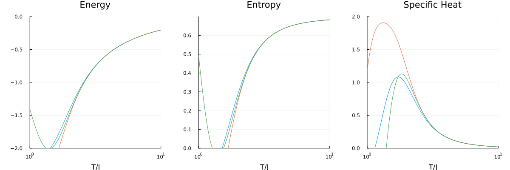

# Square Lattice Site Expansion

This example computes the linked cluster expansion on a square lattice up to
order 3.

## Setup

```@setup square
using Lincege
if !@isdefined(output_dir)
    output_dir = joinpath(pkgdir(Lincege), "examples", "outputs")
end
mkpath(output_dir)
```

Define the one-site square unit cell:

```@example square
using Lincege

square_basis = [[0.0, 0.0]]
square_pvecs = [[1.0, 0.0], [0.0, 1.0]]
square_bonds = [Bond(1, 1, [1, 0], 1), Bond(1, 1, [0, 1], 1)]
square_uc = UnitCell(square_basis, square_pvecs, square_bonds, [1])
```

One site and two orthogonal primitive vectors generate the square lattice.
The offsets `[1, 0]` and `[0, 1]` are horizontal and vertical bonds.
Equal site colors and bond types treat these sites and interactions as equivalent.

## Imaging the unit cell and lattice

Load Plots and ColorSchemes to activate Lincege's plotting capabilities.

```@example square
using Plots, ColorSchemes
image_unit_cell(square_uc)
```

```@example square
image_lattice(square_uc)
```

## Building the lattice and clusters

The following code generates clusters up to order 3, starting with translational
clusters and reducing to isomorphic clusters.

```@example square
m_order = 3
lattice = SiteExpansionLattice(m_order, square_uc)

trans_clusters = TranslationClusterSet(lattice)
clusters_from_lattice!(trans_clusters, lattice)

iso_clusters = IsomorphicClusterSet(lattice)
reduce_clusters!(iso_clusters, trans_clusters)
```

## Computing the expansion

The final NLCE expansion weights are computed recursively.

```@example square
expansion = Expansion(iso_clusters, lattice)
summation!(expansion, m_order)
```

## Writing to JSON

Write the results to a JSON file for the Ising calculation below.

```@example square
json_path = joinpath(output_dir, "square_lattice_site_expansion.json")
write_to_json(expansion, lattice, json_path)
```

For a colon-separated text file containing the same cluster data, use
`write_to_txt_file`:

```@example square
txt_path = joinpath(output_dir, "square_lattice_site_expansion.txt")
write_to_txt_file(expansion, lattice, txt_path)
```

Each row contains `n_sites : cluster_hash : bonds : coordinates : site_colors :
weights : order`. Bonds are space-separated triples, coordinates use `(x,y)`
tuples, and empty fields represent empty vectors. The header names the fields.
The Ising example below continues to read the JSON file.

## Ising Model Simulation

Load the exported clusters and create an Ising solver for each one. Compute
the NLCE observables over a temperature range, then apply Euler and Wynn
resummations. The final expression compares the bare and resummed specific
heat near `T/J = 2`.

```@example square
temperatures = collect(range(0.5, 5.0, length=200))

clusters = import_from_json(json_path)
solvers = [IsingSolver(c) for c in clusters]

nlce_result = perform_nlce(solvers, temperatures)
resummed = apply_resummations(nlce_result, [(:Euler, 2), (:Wynn, 1)])

T_idx = argmax(temperatures .>= 2.0)
(temperature = temperatures[T_idx],
 bare = nlce_result.specific_heat[end][T_idx],
 resummed = resummed.specific_heat[end][T_idx])
```

## Plotting Results

Sum the contributions through each order to plot the energy, entropy, and
specific heat as functions of temperature.

```julia
using Plots

T = nlce_result.temperatures
n_orders = length(nlce_result.energy)

energy_cumsum  = hcat([sum(nlce_result.energy[1:n]) for n in 1:n_orders]...)
entropy_cumsum = hcat([sum(nlce_result.entropy[1:n]) for n in 1:n_orders]...)
cv_cumsum      = hcat([sum(nlce_result.specific_heat[1:n]) for n in 1:n_orders]...)

plot_range = max(1, n_orders - 2):n_orders
labels = reshape(["Order $n" for n in plot_range], 1, :)

p1 = plot(T, energy_cumsum[:, plot_range]; label=false, xlabel="T/J", title="Energy")
p2 = plot(T, entropy_cumsum[:, plot_range]; label=labels, xlabel="T/J", title="Entropy", legend=:top)
p3 = plot(T, cv_cumsum[:, plot_range]; label=false, xlabel="T/J", title="Specific Heat")

plot(p1, p2, p3; layout=(1, 3), size=(900, 300))
```

The following cached plot shows convergence through order 10 for the square
lattice Ising model. It comes from a separate calculation, the code
above runs only through order 3.


